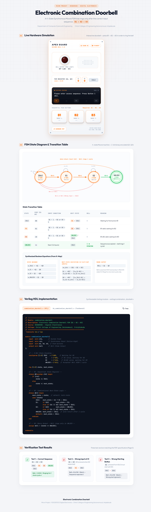

# Electronic Combination Doorbell (B1 → B2 → B3)

[](https://ajvadkp.github.io/Electronic-combination-doorbell/)
[](verilog/combination_doorbell.v)
[](verilog/tb_combination_doorbell.v)
[](app.js)
[](server.js)
[](LICENSE)

> 🚀 **Live Interactive Simulator**: Experience the full hardware doorbell model directly in your browser:  
> 👉 **[https://ajvadkp.github.io/Electronic-combination-doorbell/](https://ajvadkp.github.io/Electronic-combination-doorbell/)**

An industrial-grade, 4-state synchronous **Moore Finite State Machine (FSM)** that actuates a doorbell chime strictly upon entering the sequential combination **`B1 → B2 → B3`**. Designed with synthesizable Verilog HDL, gate-level schematic netlists, and an interactive browser-based hardware simulator featuring real-time Web Audio API chime synthesis.

Developed as a micro-project for **R25DER302: Digital Electronics**, Department of Computer Science & Engineering, **Christ College of Engineering (Autonomous), Irinjalakuda**.

---

## Showcase & System Architecture



```
  +-----------+  B1 = 1   +-----------+  B2 = 1   +-----------+  B3 = 1   +---------------+
  | IDLE (00) | --------> |  S1 (01)  | --------> |  S2 (10)  | --------> |  UNLOCK (11)  |
  +-----------+           +-----------+           +-----------+           +---------------+
        ^                       |                       |                         |
        |      Wrong / Reset    |      Wrong / Reset    |      Auto-Return        |
        +-----------------------+-----------------------+-------------------------+
                                (Bell = 0)                              (Bell = 1)
```

---

## Key Engineering Features

- **Robust Moore Sequential Architecture**: Output logic depends strictly on the current registered state, eliminating combinational output hazards, glitch pulses, and false triggers.
- **Dual-Register State Encoding**: Uses 2 D Flip-Flops ($Q_1, Q_0$) to encode 4 distinct operational states ($2^2 = 4$).
- **Strict Out-of-Sequence Rejection**:
  - Any incorrect button press (e.g., $B_3$ pressed at state $S_1$) immediately resets the FSM to `IDLE (00)`.
  - Non-initial button presses from `IDLE` (e.g., starting with $B_2$ or $B_3$) are safely ignored.
- **Dual-Domain Verification**:
  - **Synthesizable Verilog RTL**: IEEE 1364-2001 compliant module with self-checking testbench.
  - **Interactive Web Hardware Simulator**: Modeled after the *Apex Guard Secure-Bell 3.0* chassis with tactile push-buttons, live $Q_1, Q_0$ register displays, LED strobe pulses, LCD display, and synthesised two-tone chime ($784\text{ Hz} \to 523\text{ Hz}$).
- **Zero-Dependency Deployment**: Local HTTP server powered by native Node.js standard libraries, directly deployable to GitHub Pages.

---

## Finite State Machine (FSM) Specification

### 1. State Encoding

| State Symbol | State Identifier | Binary Encoding ($Q_1 Q_0$) | Bell Output | Functional Description |
|:---:|:---:|:---:|:---:|:---|
| $S_0$ | **IDLE** | `2'b00` | `0` (LOW) | System quiescent; awaiting initial valid trigger $B_1$. |
| $S_1$ | **S1** | `2'b01` | `0` (LOW) | $B_1$ verified; armed and awaiting second input $B_2$. |
| $S_2$ | **S2** | `2'b10` | `0` (LOW) | $B_1 \to B_2$ verified; armed and awaiting final input $B_3$. |
| $S_3$ | **UNLOCK** | `2'b11` | `1` (HIGH) | Complete sequence verified; bell rings for exactly 1 clock period. |

### 2. State Transition Table

| Current State ($Q_1 Q_0$) | Active Input Condition | Next State ($Q_1^+ Q_0^+$) | Bell Output | System Action |
|:---:|:---:|:---:|:---:|:---|
| `00` (IDLE) | $RST = 1$ | `00` | `0` | Synchronous reset override. |
| `00` (IDLE) | $B_1 = 1, B_2=0, B_3=0$ | `01` (S1) | `0` | Valid first input accepted $\to$ arm to $S_1$. |
| `00` (IDLE) | Any other button / No input | `00` (IDLE) | `0` | Invalid start or idle; hold in $S_0$. |
| `01` (S1) | $B_2 = 1, B_1=0, B_3=0$ | `10` (S2) | `0` | Valid second input accepted $\to$ arm to $S_2$. |
| `01` (S1) | No button pressed ($\text{no\_btn}=1$) | `01` (S1) | `0` | Hold current progress. |
| `01` (S1) | Wrong button ($B_1=1$ or $B_3=1$) | `00` (IDLE) | `0` | Sequence violation $\to$ reset to $S_0$. |
| `10` (S2) | $B_3 = 1, B_1=0, B_2=0$ | `11` (UNLOCK) | `0` | Final sequence matched $\to$ transition to UNLOCK. |
| `10` (S2) | No button pressed ($\text{no\_btn}=1$) | `10` (S2) | `0` | Hold current progress. |
| `10` (S2) | Wrong button ($B_1=1$ or $B_2=1$) | `00` (IDLE) | `0` | Sequence violation $\to$ reset to $S_0$. |
| `11` (UNLOCK) | Next rising clock edge (unconditional) | `00` (IDLE) | **`1`** | **Active ringing pulse (1 cycle)**, then auto-return. |

### 3. Synthesized Boolean Excitation Equations

Derived from Karnaugh Maps (K-Maps) using D Flip-Flops and 1-of-4 state decoders ($S_0 = \overline{Q_1}\overline{Q_0}$, $S_1 = \overline{Q_1}Q_0$, $S_2 = Q_1\overline{Q_0}$, $S_3 = Q_1Q_0$):

$$\text{no\_btn} = \overline{B_1 + B_2 + B_3}$$

$$D_1 = \overline{RST} \cdot \left[ (S_1 \cdot B_2) + (S_2 \cdot B_3) + (S_2 \cdot \text{no\_btn}) \right]$$

$$D_0 = \overline{RST} \cdot \left[ (S_0 \cdot B_1) + (S_1 \cdot \text{no\_btn}) + (S_2 \cdot B_3) \right]$$

$$\text{BELL} = Q_1 \cdot Q_0$$

---

## Repository Structure

```
.
├── .gitattributes                  # Git LF normalization & diff configuration
├── .gitignore                      # Industry-standard build & artifact ignore rules
├── LICENSE                         # MIT Open-Source License
├── README.md                       # Comprehensive engineering documentation
├── package.json                    # Project metadata & convenience scripts
├── server.js                       # Zero-dependency local development HTTP server
│
├── index.html                      # Interactive hardware simulator & technical portal
├── style.css                       # Industrial hardware chassis styling
├── sections.css                    # Documentation typography & responsive layout
├── app.js                          # Web Audio API synthesizer, LED strobe & FSM engine
├── sections.js                     # Tab switching & clipboard utilities
│
├── verilog/                        # Hardware Description Language (HDL)
│   ├── combination_doorbell.v      # Synthesizable 4-State Moore FSM RTL module
│   └── tb_combination_doorbell.v   # Self-checking verification testbench
│
├── circuit/                        # Gate-Level Logic Schematics
│   ├── electronic_combination_doorbell.circ # Complete Logisim 2.7.x netlist
│   └── schematic.jpg               # High-resolution dark-mode logic schematic
│
├── docs/                           # Project Specifications & Formal Reports
│   ├── Electronic-Combination-Doorbell.pdf  # Course micro-project assignment brief
│   └── engineering_report.md       # Comprehensive academic engineering report
│
└── assets/                         # Visual assets for documentation
    └── doorbell_showcase.png       # Web simulator showcase banner
```

---

## Verilog HDL Implementation

The RTL module is partitioned cleanly into a standard two-process FSM architecture:
1. **Synchronous State Register**: Evaluated on `@(posedge clk)` with active-high synchronous reset.
2. **Combinational Next-State Logic**: Evaluated on `@(*)` combinational sensitivity list.
3. **Continuous Moore Output Assignment**: `assign bell = (state == UNLOCK);`.

### Source Files:
- RTL Module: [`verilog/combination_doorbell.v`](verilog/combination_doorbell.v)
- Testbench: [`verilog/tb_combination_doorbell.v`](verilog/tb_combination_doorbell.v)

### Running Simulation Locally:

If you have [Icarus Verilog](http://iverilog.icarus.com/) and [GTKWave](http://gtkwave.sourceforge.net/) installed:

```bash
# Compile and execute testbench
npm run sim

# Or execute manually via iverilog:
iverilog -o sim.vvp verilog/tb_combination_doorbell.v verilog/combination_doorbell.v
vvp sim.vvp
```

Expected Output:
```text
VCD info: dumpfile doorbell_simulation.vcd opened for output.
TEST 1 PASS: Bell=1 (UNLOCK) - Correct Sequence B1 -> B2 -> B3 Verified
TEST 2 PASS: Bell=0 (Rejected) - Sequence Violation at S1 Correctly Reset to IDLE
TEST 3 PASS: Bell=0 (Ignored) - Unauthorized Starting Button Correctly Ignored
```

---

## Web Simulator & Live Demo

### 🌐 Option 1: Live Interactive Demo (No Setup Needed)
The web simulation is deployed and accessible directly via GitHub Pages:  
👉 **[https://ajvadkp.github.io/Electronic-combination-doorbell/](https://ajvadkp.github.io/Electronic-combination-doorbell/)**

### 💻 Option 2: Running Locally via Node.js
The simulator has zero external dependencies and runs with Node.js built-ins:
```bash
# Clone the repository
git clone https://github.com/AJVADkp/Electronic-combination-doorbell.git
cd Electronic-combination-doorbell

# Launch the local server
npm start
# or: node server.js
```
Open **`http://localhost:8080/`** in your browser.

### 📁 Option 3: Direct File Execution
You can also open `index.html` directly in any modern web browser without a web server.

---

## Verification Test Matrix

All test vectors specified in Page 5 of the micro-project specification are verified:

| Test ID | Test Vector Description | Input Sequence | State Path Taken | Bell Output | Verification Status |
|:---:|:---|:---:|:---:|:---:|:---:|
| **TC-01** | **Correct Combination** | $B_1 \to B_2 \to B_3$ | $\text{IDLE} \to S_1 \to S_2 \to \text{UNLOCK} \to \text{IDLE}$ | `1` (HIGH) for 1 cycle | **PASSED ✓** |
| **TC-02** | **Sequence Violation at S1** | $B_1 \to B_3$ ($B_3$ pressed when $B_2$ expected) | $\text{IDLE} \to S_1 \to \text{IDLE}$ | `0` (LOW) | **PASSED ✓** |
| **TC-03** | **Unauthorized Start Input** | $B_2$ pressed from IDLE | $\text{IDLE} \to \text{IDLE}$ | `0` (LOW) | **PASSED ✓** |
| **TC-04** | **Hardware Asynchronous Reset** | $RST = 1$ asserted during $S_1$ or $S_2$ | $S_n \xrightarrow{RST} \text{IDLE}$ | `0` (LOW) | **PASSED ✓** |

---

## Academic Credentials & Attributions

- **Course**: R25DER302 Digital Electronics Micro-Project
- **Academic Year**: 2025–2026
- **Department**: Department of Computer Science & Engineering
- **Institution**: Christ College of Engineering (Autonomous), Irinjalakuda

---

## License

This project is licensed under the [MIT License](LICENSE). You are free to use, modify, and distribute this software for educational and commercial purposes.
